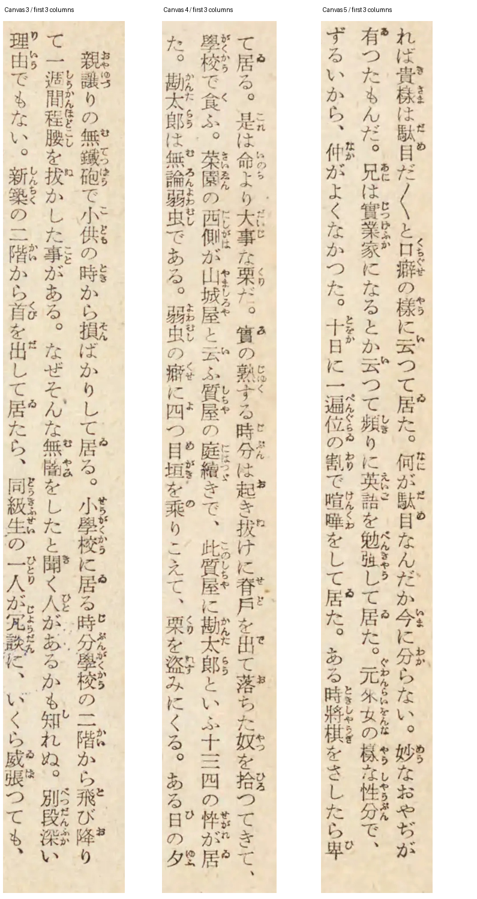

# 縦組み実スキャンの初回残差監査

基準b9b64ef。夏目漱石『坊つちやん』（岩波書店、1939・18刷、NDL PID1884801）の
本文冒頭3コマから、各コマで先に読むページの最初の3列をNN前に選んだ。
全見開きの精度評価ではなく、3抜粋・9本文列・列間LF込み392 scalarの開発対照である。
元JPEGとcrop/RGB/手転記を認識前に固定し、本文の旧字・くの字点を画像と照合した。
ルビは画像へ残し、本文用真値から除くという評価規約を明記した。
モデル学習との重複は不明。初回観測後は開発回帰であり、未知資料一般の改善率ではない。

| 経路 | none/width文字距離 / 392 | strict文字距離 / 392 |
| --- | ---: | ---: |
| 既定CLI DEIM | 13 | 10 |
| CLI帯検出 | 380 | 380 |
| PageRecognizer30（eval/default各） | 269 | 266 |
| PageRecognizer50（eval/default各） | 14 | 14 |
| PageRecognizer100（eval/default各） | 13 | 10 |

全24ページ本文組を取得した。6つのAPI経路では、検出した3列の矩形が各画像で同一だった。
その全9列を切り抜いた8単行経路×3モデルの216組も保存した。
raw Sessionとページ出力の27組は全mean bitが一致し、25本文はbyte同一だった。
残る2本文の差は末尾ASCII空白1個だけであり、主な欠落はrawに既に存在する。
PageRecognizerのDEIM経路では既存の明示縦列分割が使われておらず、
長い縦列を小さいモデルへ強く圧縮することを原因候補として調査する。
分割による回復や新しい製品改善を測定済みとはしない。

APIページ呼出し18回とCLI6プロセスを分けて記録した。内部NN forwardは計装しておらず、
呼出し数と同一視しない。入力・真値・source/model SHAは実行後も不変だった。
実行sourceとbinary SHA、CLI全stdout/stderr、API矩形/confidence、rawと全採点表を保存する。
モデルと実行binary本体は配布しない。

縮小プレビュー。測定はZIP内の元寸法RGBを使う。



出典は[NDL資料](https://dl.ndl.go.jp/pid/1884801)と
[IIIF manifest](https://dl.ndl.go.jp/api/iiif/1884801/manifest.json)。
manifestのAccess RestrictionsはPDM、attributionは国立国会図書館。
利用条件とAPIの説明は[コンテンツの利用](https://www.ndl.go.jp/use/reproduction)、
[次世代デジタルライブラリーAPI](https://lab.ndl.go.jp/service/tsugidigi/apiinfo/)。
最初の候補PID1703887はmanifest404で画像を取得できず、検索APIの先頭候補へ切り替えた。
その失敗履歴、NN前のcrop欠け修正、文字コード照合も残す。

Pillowを使えるPythonで、空の復元先へ実行する。

```sh
python3 docs/benchmarks/real-vertical-scan/reproduce.py --output tmp/vertical-scan-reproduced
```

元RGB/切抜き/真値・全API/CLIを検査し、公式scorerで12 CSV/Markdownを独立再生成する。
初回パッケージのCSV保存漏れは再現時に検出し、表の全件収録テストをRed→Greenで修正した。
別の空ディレクトリで全12表と27組のraw/ページ対応の再現成功を確認した。
製品sourceは基準コミットから変更していない。次の候補は別仕様・純粋テストから検査する。

次の調査は[容量回復候補の先行仕様](../../vertical_model_capacity_recovery.md)に従う。
